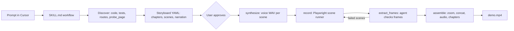
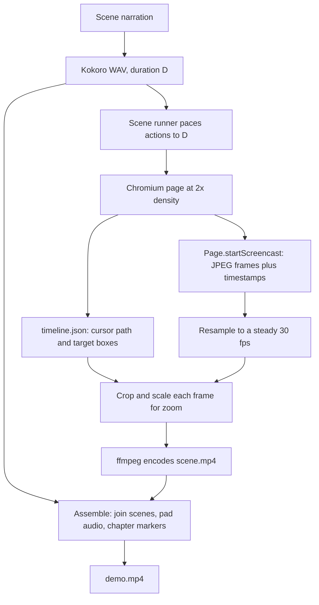

# Demo Creator

A free, local alternative to NarrateAI DemoMaker. From Cursor, give a prompt like *"Make a demo of someone signing in and creating a course"* and get a fully narrated MP4 of any web app that runs in a browser.

Cursor's agent writes the storyboard. You approve it once. The tool then records with Playwright, draws a visible cursor, applies smooth zoom, generates narration with [Kokoro](https://github.com/hexgrad/kokoro) (macOS `say` fallback), paces each scene to its audio, and assembles chapters with ffmpeg. No NarrateAI subscription. No API key.

## How a run works



## How a scene is recorded

Chrome does **not** hand back a video file. `Page.startScreencast` streams JPEG frames with timestamps. The tool saves them, applies zoom per frame from the cursor/target timeline, and ffmpeg encodes the MP4. Narration is generated **first** so the scene is paced to the audio.



Frames (instead of a direct WebM) keep zoom lined up with the timeline and keep crops sharp from the 2× capture. If screencast is unavailable, Playwright's WebM recording is used as a fallback (zoom is less precise on that path).

## Requirements

- Python 3.11+
- [uv](https://docs.astral.sh/uv/) (recommended) or pip
- ffmpeg: `brew install ffmpeg`
- espeak-ng (recommended for Kokoro): `brew install espeak-ng`
- Cursor (for the agent + MCP workflow)

## Install

```bash
cd advanced-demo-creator
uv tool install -e .
# or: uv pip install -e ".[dev]"
demo-creator install
demo-creator doctor
```

`install` merges a `demo-creator` entry into `~/.cursor/mcp.json`, copies the skill to `~/.cursor/skills/demo-creator/`, installs Playwright Chromium, and warms up TTS.

Restart Cursor after installing.

Optional better voice:

```bash
uv pip install -e ".[kokoro]"
```

Without Kokoro, macOS `say` is used automatically.

## Quick start

1. Open any web project in Cursor (app must be reachable at a URL).
2. Optionally add `.demo/profile.yaml` (see below).
3. Ask:

> Make a demo of someone signing in and creating a course.

Or:

> Given this custom theme, craft a narrated demo of every feature it exposes.

4. The agent writes `demos/<name>.yaml`, calls `validate_plan`, and **waits for your approval**.
5. After you approve, it synthesizes audio, records, checks frames, and assembles.
6. Final video: `demos/out/<name>.mp4`.

## Files written into your project

Each distinct demo prompt gets its own plan file. Three different demos → three YAML files.

| Path | Purpose | Commit? |
|------|---------|---------|
| `demos/<name>.yaml` | Storyboard (steps + narration) | Yes, for reproducible demos |
| `demos/<name>.features.md` | Feature inventory (feature tours) | Optional |
| `demos/out/<name>.mp4` | Final videos | Usually no (large) |
| `.demo/profile.yaml` | App URLs, auth, hooks | Yes |
| `.demo/runs/` | Scene cache / temp files | No (auto-gitignored on first run) |

### Why the plan file exists

- It is what you review and approve (and can edit by hand).
- It makes recordings repeatable without the agent.
- When the UI changes, the agent updates that file and only re-records changed scenes.
- It drives the scene-level cache (audio hash = narration + voice; video hash = steps + URL + duration + video settings).

### Naming and reuse

- Name is a short slug from the prompt, e.g. `sign-in-create-course`.
- Before creating a plan, the agent checks for a similar existing file and asks whether to **update** or **create new**.
- Asking for the same demo again updates the existing plan rather than duplicating it.

Suggested `.gitignore` entries (also written automatically):

```
.demo/runs/
demos/out/
```

## Plan format

```yaml
title: Signing in and creating a course
target: local
auth: admin-local
voice: { engine: kokoro, name: am_michael, speed: 1.0 }
video: { width: 1920, height: 1080, fps: 30, scale: 2 }
chapters:
  - title: Signing in
    scenes:
      - id: login
        start_url: /login/index.php
        narration: "Let's start by signing in with an administrator account."
        pace: spread   # spread | front | back
        hold_after: 0.5
        steps:
          - { action: fill, target: { label: Username }, value: "${DEMO_USER}" }
          - { action: fill, target: { label: Password }, value: "${DEMO_PASS}", mask: true }
          - { action: click, target: { role: button, name: Log in }, zoom: auto }
          - { action: wait_for, target: { text: Dashboard } }
```

**Targets:** `testid`, `role`+`name`, `label`, `text`, `css`, optional `frame` for iframes.

**Actions:** `goto`, `click`, `fill`, `type`, `select`, `check`, `hover`, `press`, `scroll`, `wait_for`, `wait`, `highlight`.

**Zoom per step:** `auto` (default for click/fill/type), `off`, or a number like `1.6`.

**Variables:** `${ENV}` from `env_file` / environment; `${UNIQUE}` → `MMDD-HHMM` for remote-safe names. Use `mask: true` for secrets.

See `examples/plans/` and `skill/references/plan-schema.md`.

## App profile (`.demo/profile.yaml`)

```yaml
targets:
  local:   { url: http://localhost:8080, auth: admin-local }
  staging: { url: https://staging.example.com, auth: staging-sso, unique_suffix: true }
hooks:
  before_record: ./scripts/demo-reset.sh
  after_record: ./scripts/demo-cleanup.sh
selector_sources: [tests/e2e, features]
login:
  url: /login
  fields: { username: "#email", password: "#password" }
  submit: "button[type=submit]"
env_file: .env.demo
```

Examples: `examples/profiles/totara.yaml`, `examples/profiles/nextjs.yaml`.

Works with **any** browser app — React, Vue, Django, Rails, Laravel, PHP/Totara, Storybook, etc. The profile is optional; without it the agent discovers routes and selectors itself.

## Logins

- **Inline credentials** in plan steps via `${DEMO_USER}` / `${DEMO_PASS}` (from `.env.demo`).
- **SSO / magic link / 2FA:** call MCP `save_auth(label, start_url, ...)`. A headed browser opens; after you finish, the session is saved to `~/.demo-creator/auth/<label>.json` and reused via `auth: <label>` in the plan.

## MCP tools

| Tool | Purpose |
|------|---------|
| `probe_page` | Title, selectors, a11y snapshot, screenshot |
| `save_auth` | Interactive login → saved storage state |
| `validate_plan` | Schema + length estimates (approval) |
| `synthesize` | TTS per scene (cached) |
| `record` | Record scenes (cursor + screencast + zoom) |
| `extract_frames` | Sample PNGs for QA |
| `assemble` | Final MP4 with chapters |
| `render` | synthesize + record + assemble |

## CLI

```bash
demo-creator install          # Cursor MCP + skill + Chromium
demo-creator doctor           # dependency checks
demo-creator validate demos/foo.yaml
demo-creator render demos/foo.yaml [--headed] [--force] [-o out.mp4]
demo-creator runs             # list .demo/runs/
demo-creator serve            # MCP stdio (used by Cursor)
```

## Pipeline steps (order matters)

| Step | MCP tool / CLI | What it does |
|------|----------------|--------------|
| Validate | `validate_plan` | Schema check + length estimates; **approve before first full record** |
| Synthesize | `synthesize` | TTS → per-scene `audio.wav` (cached by narration + voice) |
| Record | `record` | Playwright screencast + cursor → `scene.mp4` (paced to existing WAV) |
| QA | `extract_frames` | Sample PNGs under the run for visual checks |
| Assemble | `assemble` | Join scenes, mux audio, chapter markers → `demos/out/<name>.mp4` |
| Shortcut | `render` | synthesize + record + assemble in one call |

Always **synthesize before record** when narration text or voice settings change. `record` alone reuses the cached WAV and will still speak the old line even if the YAML narration was updated.

### Caching and redoing scenes

- **Audio cache key:** narration text + voice settings.
- **Video cache key:** steps + start URL + audio duration + video settings.
- Edit one scene → re-run only that scene id (`scenes=[id]`), then `assemble`.
- Keep the same `run_id` under `.demo/runs/` so unchanged scenes stay cached.
- Prefer an **absolute** `output` path for `assemble` when writing into the project’s `demos/out/`.

| You changed… | Run (in order) |
|--------------|----------------|
| **Narration text** (or voice) | `synthesize` (`force`) → `record` (`force`) → `assemble` |
| Steps / selectors only (same narration) | `record` (`force`) → `assemble` |
| Whole tour | `render` with `force`, or synthesize/record all scenes then `assemble` |

Force everything: `render(..., force=True)` or `demo-creator render --force`.

**Login pages with saved auth:** if `auth` is set at plan level, logged-in cookies can redirect away from `/login`. Use per-scene `auth: none` (or `""`) for guest/login scenes so they stay on the login screen.

## Voice

Default: Kokoro `am_michael` (male American English). Set in the plan:

```yaml
voice: { engine: kokoro, name: am_michael, speed: 1.0 }
# or
voice: { engine: say, name: Alex, speed: 1.0 }
```

## Troubleshooting

| Problem | Fix |
|---------|-----|
| ffmpeg not found | `brew install ffmpeg` |
| Chromium missing | `demo-creator install` |
| Selector not found | `probe_page`; prefer testid/role; set `frame` for iframes |
| Auth expired | Re-run `save_auth` |
| Timing drift | Shorten narration or adjust `pace` / `hold_after` |
| Long demos slow | Rely on scene cache; re-record only changed scene ids |
| Video still has old narration after YAML edit | Run `synthesize` with `force` for that scene, then `record` + `assemble` — `record` alone does not refresh TTS |

Failed steps leave `error.png` and an accessibility snapshot under `.demo/runs/<id>/scenes/<scene>/`.

## Roadmap

Subtitles, background music, title/end cards, multi-language narration, CI re-render, voice cloning.

## License

MIT. Kokoro is Apache-2.0. Use of optional non-commercial voice models is your responsibility if you add them later.
